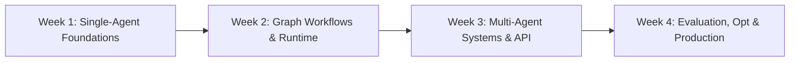

# Google Agent Development Kit (ADK) — 4-Week Mastery Plan

An intensive, structured, hands-on 4-week study plan (2 hours/day, total 56 hours) to master building, testing, evaluating, and deploying production-grade AI agents and multi-agent systems using the **[Google Agent Development Kit (ADK)](https://adk.dev/)**.

---

## 📌 Table of Contents

1. [Overview & What is Google ADK?](#overview--what-is-google-adk)
2. [The 2-Hour Daily Study Framework](#the-2-hour-daily-study-framework)
3. [4-Week Curriculum Roadmap](#4-week-curriculum-roadmap)
   - [Week 1: Foundations of Google ADK & Single-Agent Engineering](#week-1-foundations-of-google-adk--single-agent-engineering)
   - [Week 2: Workflows, Graph Runtime & Advanced Tooling](#week-2-workflows-graph-runtime--advanced-tooling)
   - [Week 3: Multi-Agent Systems, Task Delegation & Architectures](#week-3-multi-agent-systems-task-delegation--architectures)
   - [Week 4: Evaluation, Testing, Optimization & Production Deployment](#week-4-evaluation-testing-optimization--production-deployment)
4. [Environment Setup & Quickstart](#environment-setup--quickstart)
5. [CLI Commands Cheatsheet](#cli-commands-cheatsheet)
6. [Core Code Patterns](#core-code-patterns)
7. [Official Resources & Documentation](#official-resources--documentation)

---

## Overview & What is Google ADK?

The **[Agent Development Kit (ADK)](https://adk.dev/)** is an open-source, code-first framework developed by Google designed to make AI agent development adhere to robust software engineering principles.

### Key Capabilities:
- **Code-First & Modular:** Define agents cleanly in Python with typed interfaces and standard software patterns.
- **Model & Deployment Agnostic:** Optimized for Google Gemini (Gemini 2.5 Flash, Gemini 2.5 Pro) with seamless support for Google AI Studio and Google Cloud Vertex AI.
- **Graph-Based Workflow Runtime:** Orchestrate deterministic execution flows, branching, parallel execution, loops, and state management.
- **Built-in Developer Tooling:** Interactive CLI (`adk run`), local visual debugging Web UI (`adk web`), and REST API server (`adk api_server`).
- **Production-Ready Lifecycle:** Built-in evaluation sets (`adk eval`), test harnesses (`adk test`), instruction optimization via GEPA (`adk optimize`), and cloud deployment (`adk deploy`).

---

## The 2-Hour Daily Study Framework

To maximize retention and build practical muscle memory, split each 2-hour daily session into four phases:

| Time | Phase | Description |
| :--- | :--- | :--- |
| **30 min** | **Theory & Docs** | Study official [adk.dev](https://adk.dev/) docs, concepts, and API designs. |
| **60 min** | **Hands-On Coding** | Implement code, write custom tools, build workflows, and test locally. |
| **20 min** | **Debugging & Inspection** | Inspect traces, session state, and execution via `adk web` and terminal logs. |
| **10 min** | **Review & Commit** | Document notes, push progress to Git, and review the next day's objectives. |

---

## 4-Week Curriculum Roadmap



---

### Week 1: Foundations of Google ADK & Single-Agent Engineering
**Goal:** Master the fundamentals of Google ADK, project scaffolding, tool registration, session state, and interactive debugging.

#### Day 1: Introduction to Agentic Systems & Google ADK Architecture
- **Topics:**
  - Evolution from single LLM completions to Agentic AI (Perception $\to$ Reasoning $\to$ Action $\to$ Reflection).
  - Why Google ADK? Comparing ADK to LangChain, AutoGen, and CrewAI.
  - ADK design principles: Code-first, deterministic graphs, and developer ergonomics.
- **Practical (60m):**
  - Verify Python virtual environment and install `google-adk`.
  - Obtain and configure `GOOGLE_API_KEY` from [Google AI Studio](https://aistudio.google.com/apikey).
  - Verify CLI availability: `adk --version`.
- **Output:** Working local environment and API connectivity.

#### Day 2: First Agent & ADK Tooling (`agent.py`, `adk run`, `adk web`)
- **Topics:**
  - ADK project anatomy: `agent.py`, `root_agent`, `.env`, and dependencies.
  - Project scaffolding with `adk create <app_name>`.
  - Terminal interactive loop via `adk run`.
  - Local browser-based developer playground via `adk web`.
- **Practical (60m):**
  - Create a new agent project: `adk create starter_agent`.
  - Explore the generated code and test basic conversations in terminal and browser.
- **Output:** Running starter agent interacting through CLI and Web UI.

#### Day 3: System Prompts, Instructions & Gemini Model Configuration
- **Topics:**
  - Structuring agent personas, constraints, and instructions in `instruction`.
  - Configuring models: `gemini-2.5-flash` (low latency, efficient tool calling) vs `gemini-2.5-pro` (complex reasoning).
  - Tuning generation parameters: temperature, top_k, top_p, and safety settings.
- **Practical (60m):**
  - Build a **Tech Stack Advisor Agent** that provides tailored architectural advice based on project requirements.
- **Output:** Tested agent with specialized prompt engineering and parameter tuning.

#### Day 4: Custom Tools & Type-Safe Function Calling
- **Topics:**
  - How ADK auto-generates tool schemas from Python docstrings and type annotations.
  - Designing robust input/output signatures with Python typing and Pydantic.
  - Error handling inside tools (graceful error strings vs uncaught exceptions).
- **Practical (60m):**
  - Create custom Python tools:
    - Calculator with math evaluation.
    - System health monitor (fetching CPU, RAM, disk space using `psutil`).
  - Register tools into `Agent(tools=[...])`.
- **Output:** Agent capable of reliably invoking custom Python functions.

#### Day 5: Grounding, Search & External API Integration
- **Topics:**
  - Dynamic tool execution and grounding.
  - Connecting agents to external REST APIs using `httpx`.
  - Integrating Google Search grounding.
  - Overview of Model Context Protocol (MCP) in modern agent architectures.
- **Practical (60m):**
  - Build an **API Fetcher Agent** that queries a public weather or GitHub API, parses JSON, and provides grounded answers.
- **Output:** Agent integrating external live data sources.

#### Day 6: Sessions, Conversation History & State Management
- **Topics:**
  - Session lifecycle: Working memory vs persistent memory.
  - Managing turn-by-turn conversation context.
  - Reading and updating state variables across agent turns.
- **Practical (60m):**
  - Build an **Interactive Onboarding Bot** that collects user preferences across multiple turns and maintains state.
- **Output:** Multi-turn conversational agent with state awareness.

#### Day 7: Week 1 Consolidation & Mini-Project 1
- **Topics:**
  - Review Week 1 concepts and code patterns.
- **Mini-Project: DevPulse Agent**
  - Build a CLI developer companion that can:
    1. Inspect git repository status and recent commits.
    2. Search software documentation via external APIs.
    3. Generate pull request descriptions based on git diffs.
- **Output:** Complete, documented, and tested `DevPulse` agent pushed to GitHub.

---

### Week 2: Workflows, Graph Runtime & Advanced Tooling
**Goal:** Build deterministic execution graphs, branching pipelines, retry/reflection loops, and Human-in-the-Loop approval systems.

#### Day 8: Introduction to ADK Graph Workflows
- **Topics:**
  - Autonomous agents vs Deterministic agent workflows.
  - Graph runtime fundamentals: Nodes, Directed Edges, Graph State, and Execution Engine.
  - Linear chains vs Directed Acyclic Graphs (DAGs).
- **Practical (60m):**
  - Create your first multi-step sequential workflow: `Input -> Processor Agent -> Formatter Agent -> Final Output`.
- **Output:** Working sequential graph workflow.

#### Day 9: Branching, Parallel Execution & Conditional Routing
- **Topics:**
  - Conditional edge routing based on state or agent classification.
  - Fan-out / Fan-in parallel execution patterns.
  - Merging parallel node outputs into consolidated state.
- **Practical (60m):**
  - Build an **Inquiry Classifier Workflow**:
    - Classifier node routes queries to either `Technical Support Node`, `Billing Node`, or `General FAQ Node`.
- **Output:** Dynamic branching workflow with conditional routing.

#### Day 10: Loops, Retries & Self-Correction (Generator-Critic Pattern)
- **Topics:**
  - Cyclic graphs and iterative refinement loops.
  - The Generator-Critic / Self-Correction pattern.
  - Preventing infinite loops: Max iterations, threshold metrics, and loop breaking.
  - Handling transient API failures with retry policies.
- **Practical (60m):**
  - Build an **Automated Code Generator & Refiner**:
    - Generator writes code $\to$ Critic tests and reviews code $\to$ Loops until pass or max 3 iterations.
- **Output:** Working self-correcting agent loop.

#### Day 11: Human-in-the-Loop (HITL) & Approval Workflows
- **Topics:**
  - Enterprise safety: Why and when agents need human approval.
  - Suspending graph execution, raising approval requests, and resuming upon human input.
  - Inspecting and approving pending actions in `adk web`.
- **Practical (60m):**
  - Build a **Customer Refund / Deployment Agent** requiring human confirmation for actions over a threshold value.
- **Output:** HITL-enabled workflow with pause/resume capabilities.

#### Day 12: Long-Term Memory, Persistence & Context Windowing
- **Topics:**
  - State persistence across process restarts (SQLite / file store).
  - Context window management: Summarization strategies, sliding windows, and memory pruning.
  - Checkpointing workflow state for fault tolerance.
- **Practical (60m):**
  - Configure persistent storage for session states and verify recovery after server restart.
- **Output:** Persistent agent that remembers user state across restarts.

#### Day 13: Structured Outputs & Typed Schema Validation
- **Topics:**
  - Enforcing strict JSON schema responses using Pydantic models.
  - Validating and parsing LLM output reliably.
  - Handling parsing errors and requesting retries.
- **Practical (60m):**
  - Build a **Resume & Job Description Matcher** that outputs strict JSON containing match scores, missing skills, and interview question suggestions.
- **Output:** Agent producing guaranteed structured typed outputs.

#### Day 14: Week 2 Consolidation & Mini-Project 2
- **Topics:**
  - Review of graph workflows, loops, and HITL patterns.
- **Mini-Project: DocReviewer Workflow**
  - Build a document review pipeline:
    1. Ingests Markdown / text documents.
    2. Runs grammar and technical accuracy checks in parallel.
    3. Synthesizes findings and proposes diffs.
    4. Triggers HITL approval before writing revised output to disk.
- **Output:** Tested `DocReviewer` graph workflow committed to repository.

---

### Week 3: Multi-Agent Systems, Task Delegation & Architectures
**Goal:** Design complex multi-agent architectures using supervisors, hierarchical delegation, peer collaboration, and REST API serving.

#### Day 15: Multi-Agent Architecture Principles
- **Topics:**
  - Single monolithic agent vs multi-agent specialization.
  - Inter-agent communication protocols: Shared memory vs message passing.
  - Architectural patterns: Supervisor/Worker, Hierarchical, Peer-to-Peer, and Router.
- **Practical (60m):**
  - Architect and map out a 3-agent research team on paper and initialize project structure.
- **Output:** Architecture diagram and initial multi-agent skeleton.

#### Day 16: The Supervisor / Orchestrator Pattern & Task API
- **Topics:**
  - Building a central Supervisor Agent that plans and delegates tasks.
  - Sub-agents and the ADK Task API.
  - Collecting sub-agent responses and synthesizing final user deliverables.
- **Practical (60m):**
  - Build a **Research & Report Team**:
    - Supervisor receives user prompt $\to$ delegates research to `SearchAgent` $\to$ delegates formatting to `WriterAgent`.
- **Output:** Working supervisor-orchestrated multi-agent system.

#### Day 17: Hierarchical & Sequential Multi-Agent Teams
- **Topics:**
  - Multi-tier agent hierarchies (Manager $\to$ Specialists $\to$ Executors).
  - Scope isolation: Giving sub-agents restricted tools and context.
- **Practical (60m):**
  - Build a **Product Launch Planner**:
    - Product Manager Agent oversees Marketing Agent, Engineering Agent, and Legal Review Agent.
- **Output:** Hierarchical multi-agent system.

#### Day 18: Collaborative & Swarm Architectures
- **Topics:**
  - Peer-to-peer agent collaboration without a single central orchestrator.
  - Consensus algorithms, voting mechanisms, and resolving contradictory agent outputs.
- **Practical (60m):**
  - Build a **Code Architecture Debate Panel**:
    - Security Specialist, Performance Specialist, and Simplicity Advocate critique a technical design proposal and produce a consensus recommendation.
- **Output:** Multi-agent collaborative consensus system.

#### Day 19: Exposing Agents via REST API (`adk api_server`)
- **Topics:**
  - Serving ADK agents via FastAPI with `adk api_server`.
  - REST endpoints: Chat completions, session management, and streaming (SSE).
  - Integrating frontend applications and webhooks.
- **Practical (60m):**
  - Launch `adk api_server` for your multi-agent system.
  - Write a Python client script (`client.py`) using `httpx` to communicate with the agent API.
- **Output:** Running REST API server serving agents with automated client calls.

#### Day 20: Telemetry, Observability & Tracing
- **Topics:**
  - OpenTelemetry integration in ADK (`adk telemetry`).
  - Tracing agent execution: Tool call latencies, token consumption, and model roundtrips.
  - Detecting agent bottlenecks and debugging tool invocation failures.
- **Practical (60m):**
  - Enable and inspect telemetry data for multi-agent workflows.
  - Analyze trace spans for complex tool calls.
- **Output:** Observable agent workflow with performance traces.

#### Day 21: Week 3 Consolidation & Mini-Project 3
- **Topics:**
  - Review of multi-agent delegation, orchestration, and API servers.
- **Mini-Project: SupportOps Multi-Agent Platform**
  - Build an automated IT Incident Response Agent Team:
    1. `TriageAgent`: Categorizes incoming tickets (Network, Database, Auth).
    2. `DiagnosticAgent`: Runs simulated diagnostics using custom tools.
    3. `ResolutionAgent`: Drafts incident reports and recommended remediation steps.
    4. Expose the entire team via `adk api_server`.
- **Output:** Fully functional `SupportOps` platform pushed to GitHub.

---

### Week 4: Evaluation, Testing, Optimization & Production Deployment
**Goal:** Implement automated testing, LLM-as-a-judge evaluations, prompt optimization via GEPA, containerization, and deploy a comprehensive capstone.

#### Day 22: Testing AI Agents with `adk test`
- **Topics:**
  - Challenges in testing non-deterministic LLM agents.
  - Unit testing individual tools with `pytest`.
  - Creating test JSON specs for deterministic agent assertions.
  - Running automated agent test suites with `adk test`.
- **Practical (60m):**
  - Write test suites asserting tool selection correctness, output formats, and edge-case handling.
- **Output:** Green passing test suite executed via `adk test`.

#### Day 23: Evaluation Sets & Benchmarking (`adk eval`, `adk eval_set`)
- **Topics:**
  - Golden evaluation datasets: Inputs, expected tool calls, and ground-truth references.
  - Managing evaluation sets using `adk eval_set`.
  - LLM-as-a-judge evaluation metrics: Faithfulness, tool selection precision/recall, and response quality.
  - Running evaluations with `adk eval`.
- **Practical (60m):**
  - Create an evaluation dataset of 15 realistic user queries.
  - Run `adk eval` and generate evaluation benchmark reports.
- **Output:** Quantitative evaluation benchmark report.

#### Day 24: Instruction Optimization with GEPA (`adk optimize`)
- **Topics:**
  - The GEPA (Generative Evolutionary Prompt Algorithm) optimizer in ADK.
  - Automated prompt optimization based on evaluation set performance.
  - Analyzing optimized prompt variants vs baseline prompts.
- **Practical (60m):**
  - Run `adk optimize` against your agent and evaluation set.
  - Compare accuracy metrics before and after instruction optimization.
- **Output:** Optimized agent instruction with documented benchmark improvement.

#### Day 25: Containerization & Cloud Deployment (`adk deploy`)
- **Topics:**
  - Writing production `Dockerfile` for ADK applications.
  - Managing environment secrets safely in production.
  - Deploying to Google Cloud Run (serverless container autoscaling).
  - Deploying to Vertex AI Agent Engine / Reasoning Engine.
  - Exploring `adk deploy` options.
- **Practical (60m):**
  - Build and run a local Docker container running `adk api_server`.
  - Write Cloud Run deployment script / instructions.
- **Output:** Verified Docker image running your agent service locally.

#### Day 26: Security, Guardrails & Production Readiness
- **Topics:**
  - Prompt injection prevention and input sanitization.
  - Tool execution security: Sandboxing, principle of least privilege.
  - Rate limiting, token budgets, and cost monitoring.
  - Production readiness checklist (Logging, health checks, graceful timeouts).
- **Practical (60m):**
  - Implement guardrail validators on user inputs and sanitize tool outputs.
- **Output:** Hardened, production-ready agent application.

#### Day 27: Capstone Project (Part 1) — Architecture & Implementation
- **Project: Enterprise Market Intelligence & Decision Analyst**
  - A comprehensive multi-agent system combining:
    1. **Supervisor Agent:** Deconstructs complex business queries into tasks.
    2. **Research Agent:** Performs grounded web searches and gathers market data.
    3. **Quantitative Analyst Agent:** Runs Python data analysis / calculation tools.
    4. **Executive Summary Agent:** Generates structured executive reports.
    5. **Graph Workflow:** Includes quality checks and Human-in-the-Loop review for recommendations.
- **Practical (120m):**
  - Implement agents, graph workflow, and custom tools.
- **Output:** Core capstone codebase functioning end-to-end.

#### Day 28: Capstone Project (Part 2) — Evaluation, Packaging & Retrospective
- **Practical (120m):**
  1. Build an evaluation set (`adk eval_set`) and run benchmark evaluation (`adk eval`).
  2. Write automated tests and verify with `adk test`.
  3. Package with Docker and document API endpoints.
  4. Final 4-week retrospective: Document lessons learned, architectural insights, and future roadmap.
- **Output:** Complete, evaluated, production-packaged Capstone project pushed to GitHub.

---

## Environment Setup & Quickstart

This repository contains a pre-configured Python virtual environment with `google-adk` installed.

### 1. Activate Virtual Environment
```bash
# macOS / Linux
source bin/activate
```

### 2. Configure Environment Variables
Copy `.env.example` to `.env` and insert your Google AI API key:
```bash
cp .env.example .env
```
Edit `.env`:
```ini
GOOGLE_API_KEY=your_actual_gemini_api_key_here
GOOGLE_GENAI_USE_ENTERPRISE=0
```

### 3. Verify ADK Installation
```bash
adk --version
# Expected: adk, version 2.10.x
```

### 4. Create and Run Your First Agent
```bash
# Create an agent project
adk create my_agent

# Run agent in interactive terminal mode
adk run my_agent

# Or launch local developer Web UI
adk web my_agent
```

---

## CLI Commands Cheatsheet

| Command | Purpose |
| :--- | :--- |
| `adk create <app>` | Scaffolds a new agent project with templates |
| `adk run <app>` | Runs interactive chat loop in the terminal |
| `adk web <app>` | Launches visual developer Web UI for testing and state inspection |
| `adk api_server <app>` | Starts a FastAPI REST API server |
| `adk test <app>` | Executes pytest suites on agent test specifications |
| `adk eval <app>` | Evaluates agent performance against eval sets |
| `adk eval_set` | Manages golden evaluation datasets |
| `adk optimize <app>` | Optimizes agent instructions using the GEPA optimizer |
| `adk deploy <app>` | Deploys agent to Google Cloud Run or Vertex AI |
| `adk telemetry` | Manages OpenTelemetry configuration |

---

## Core Code Patterns

### 1. Minimal ADK Agent (`agent.py`)
```python
from google.adk.agents.llm_agent import Agent

root_agent = Agent(
    model='gemini-2.5-flash',
    name='assistant',
    description='A helpful general-purpose assistant.',
    instruction='Answer user questions clearly and concisely.',
)
```

### 2. Agent with Custom Typed Tools
```python
from google.adk.agents.llm_agent import Agent

def convert_currency(amount: float, from_currency: str, to_currency: str) -> dict:
    """Converts money between currencies.
    
    Args:
        amount: The monetary amount to convert.
        from_currency: 3-letter currency code (e.g. USD, EUR, IDR).
        to_currency: 3-letter target currency code.
    """
    # Tool logic / API call
    rates = {"USD_IDR": 16200.0, "EUR_IDR": 17500.0}
    pair = f"{from_currency.upper()}_{to_currency.upper()}"
    rate = rates.get(pair, 1.0)
    return {
        "original_amount": amount,
        "from": from_currency,
        "to": to_currency,
        "converted_amount": amount * rate
    }

root_agent = Agent(
    model='gemini-2.5-flash',
    name='finance_assistant',
    instruction='You help users with currency calculations. Always use convert_currency tool for conversions.',
    tools=[convert_currency]
)
```

---

## Official Resources & Documentation

- **Official ADK Documentation:** [https://adk.dev/](https://adk.dev/)
- **ADK Python GitHub Repository:** [https://github.com/google/adk-python](https://github.com/google/adk-python)
- **ADK Recipes & Examples:** [https://github.com/google/adk-recipes](https://github.com/google/adk-recipes)
- **ADK Community Extensions:** [https://github.com/google/adk-python-community](https://github.com/google/adk-python-community)
- **Google AI Studio API Keys:** [https://aistudio.google.com/apikey](https://aistudio.google.com/apikey)

---

## License & Maintenance

Maintained by **Dikshie Fauzie** (`dikshie@gmail.com`).  
Synchronized with GitHub: [https://github.com/dikshie/googleadk/](https://github.com/dikshie/googleadk/)
